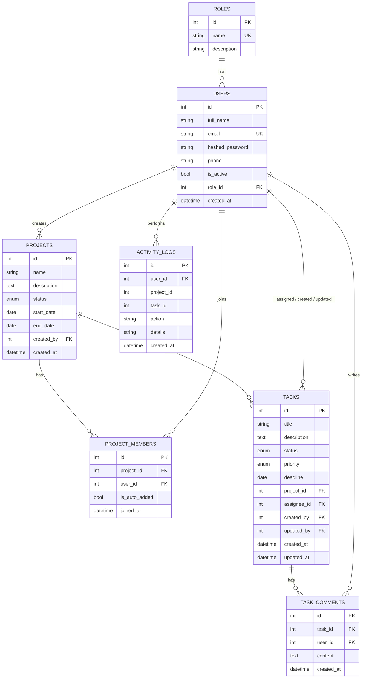

# ER Diagram

Notes
- `project_members` has a unique key on (`project_id`, `user_id`).
- Membership is assigned explicitly by an Admin. Existing rows marked `is_auto_added` from earlier versions are removed by migration `003_remove_automatic_project_members.sql`; tasks relying on those automatic memberships are unassigned (also handled automatically at startup).
- Deleting a project cascades to its members, tasks and comments.
- Deleting a user sets `tasks.assignee_id` and `activity_logs.user_id` to NULL.
- Enums: task status (To Do, In Progress, Review, Completed), priority (Low, Medium, High, Critical), project status (Planning, Active, On Hold, Completed).
- Plain SQL for MySQL: `backend/migrations/001_initial_schema.sql`.
